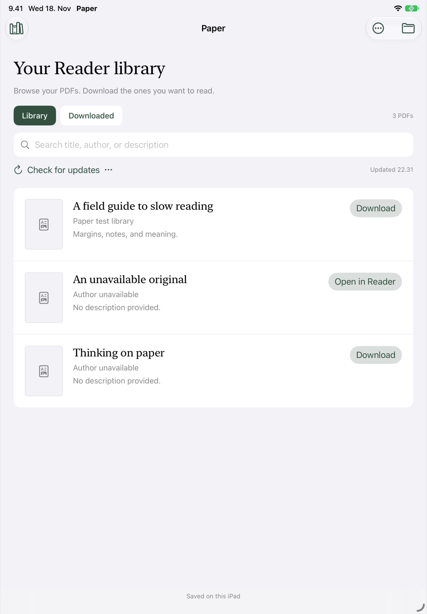
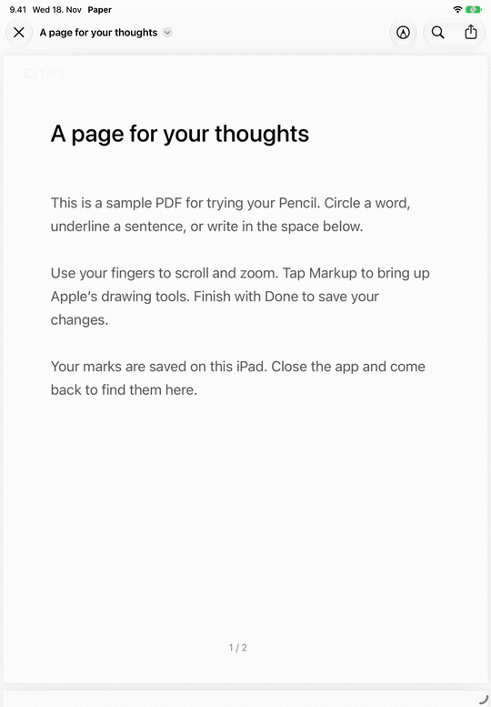

# Paper

An iPad reading library for scribbling with Apple Pencil, connected to Readwise Reader. Write directly on Reader articles and EPUBs with Apple's native pen, highlighter, eraser and lasso, or mark up PDFs in Quick Look. Originals stay untouched, and you can turn selected marked pages into editable review notes with Claude, then send them to Reader as highlights.

[Watch the 23-second demo](docs/demo.mp4) · Draw on a sample PDF with Markup, save, and return to Downloaded.

<table>
  <tr>
    <td></td>
    <td></td>
  </tr>
  <tr>
    <td>Browse your Reader PDFs and download them for offline reading.</td>
    <td>Write directly on the PDF using native Markup. <a href="docs/demo.mp4">Watch the MP4</a> · <a href="docs/images/markup.png">Still screenshot</a></td>
  </tr>
</table>

Captured from the iPad simulator using synthetic sample documents. The demo is silent; the animated preview loops.

## Try it

You need a Mac with Xcode, an iPad running iPadOS 18+, and your own Apple signing team. Readwise Reader synchronization needs your Reader account/token; Claude analysis optionally needs your own Anthropic API key and incurs usage charges.

1. Open `Paper.xcodeproj` in Xcode. Choose your signing team for the app and test targets. For a separate installation, choose your own bundle identifier; preserve the existing identity when updating an existing Paper library.
2. Choose an iPad simulator or your own connected iPad and run the Paper scheme. Hardware needs Developer Mode.
3. Connect Reader in the app; enter the optional Anthropic key in AI settings. Keys stay in separate Keychain services. Check that library entries load, then open an article, write on it with the Pencil, and reopen it to see your ink.

Verified from a clean clone on 18 November 2026: Xcode discovered all three targets and the Paper scheme; all 34 signed unit tests passed on the iPad Air 11-inch (M4), iOS 27.0 simulator. A new adopter’s physical installation and live Reader/Anthropic accounts still need verification.

The [usage guide](docs/usage.md) describes library, review, delivery and storage behavior, with dated research and historical pricing estimates. Check your provider's current pricing. Analysis sends selected page images and source text to Anthropic; sending a reviewed note to Reader is a separate manual action. Real Reader passage matching and downstream placement remain unverified.

## Make it yours

The PDF storage, native Markup wrapper, Reader client and review workflow can be adapted independently. Read [INTEGRATE.md](INTEGRATE.md), or give your agent this prompt:

> Read INTEGRATE.md and help me adapt this project to my setup. First understand what I want and inspect my environment, then propose the smallest useful integration.

Developer commands and data-preservation rules live in [AGENTS.md](AGENTS.md). The original code is available under the [MIT License](LICENSE). Third-party dependencies and assets retain their own terms.

## Install on your iPad and keep it working

Paper is distributed as source: build it with your own Apple signing account. A Mac is needed for the initial build. Free Apple development signing expires after **seven days**, so choose a renewal method:

| Method | What you need for renewal |
| --- | --- |
| Xcode | Rebuild and install from your Mac before expiry |
| [SideStore](https://docs.sidestore.io/docs/installation/prerequisites) | Wi-Fi with internet and LocalDevVPN on the iPad; your Mac can be off |
| [AltStore Classic](https://faq.altstore.io/altstore-classic/altserver) | A reachable computer running AltServer |
| [Sideloadly](https://sideloadly.io/) | A computer running its automatic refresh service |

For SideStore, follow its [installation guide](https://docs.sidestore.io/docs/installation/install), including the first self-refresh, then import your built `.ipa` in My Apps → +. Build and package it with the commands in [INTEGRATE.md](INTEGRATE.md#package-for-sidestore); SideStore does the signing, so the Mac build needs no device. When updating an existing Paper installation, back up first, enable Customize AppID, retain its original bundle ID and signing team, and uncheck Append Team ID. Keep Paper installed to preserve its library.

Check Paper’s days remaining in SideStore and refresh before expiry. SideStore attempts background refresh; it has not been verified for Paper, so manually refresh every few days until you confirm it works on your device. LocalDevVPN is needed during renewal; downloaded reading and handwriting work offline without it.

The original installation’s SideStore migration and launch were verified on 18 November 2026, with all 35 saved files unchanged. Reader and Anthropic credentials carried over. The PencilKit reader build was later installed in place through SideStore with the library and existing ink preserved.

[Paid Apple Developer membership](https://developer.apple.com/programs/) offers longer-lived signing for US$99/year or local equivalent. TestFlight requires that membership and [each build expires after 90 days](https://developer.apple.com/help/app-store-connect/test-a-beta-version/testflight-overview/).
